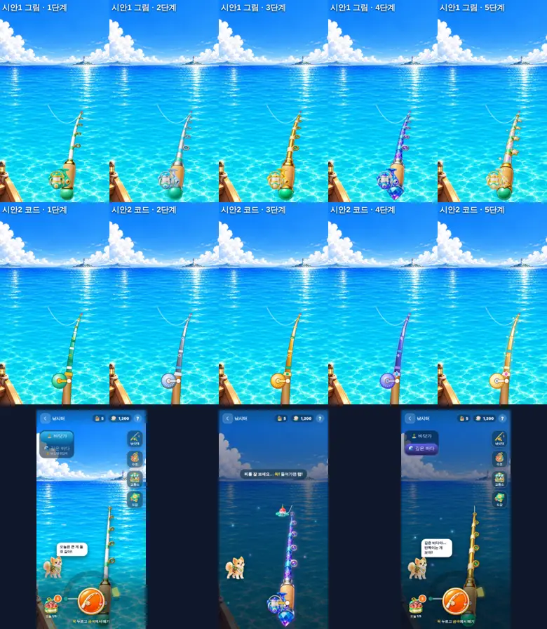

# 낚시 업그레이드 구성안 (v13.185.0)

선생님 · 학생 피드백
1. "물고기 추가 — **심해 물고기**."
2. "**낚싯대를 강화해도 낚싯대가 똑같아 보이고, 처음 낚싯대도 코드로 만든 낚싯대다.**"

## 1. 낚싯대: 단계마다 다른 모양

> **v13.186.0에서 바꿈**: 시안 1(그림 조각)을 운영 폰에서 보니 384px 그림이 약 4배로 늘어나 흐릿했다(선생님 피드백 "그래픽이 왜이랴"). 그래서 몸통은 **벡터(늘 선명)로 다시 그리되, 단계별 그림의 모양을 따라** 마디 감개 색 · 고리 모양(동그라미 · 보석 · 별) · 손잡이 끝(초록 구슬 · 은 마개 · 금 마개+에메랄드 · 보석 · 별) · 빛 · 반짝이를 단계마다 다르게 했다. 릴은 단계별 릴 그림 그대로. 아래 표는 v13.185.0 때의 비교다.

**원인**: 낚시 화면의 낚싯대는 휘는 손맛 때문에 코드(SVG 곡선)로 그렸고, 단계마다 **색만 조금** 달랐다. 단계별 그림(`pov-rod` · `pov-rod-t2~t5`, 그림 31)은 강화 창에서만 썼다.

| | 시안 1: 그림을 조각내 곡선에 붙이기 (**선택**) | 시안 2: 코드 낚싯대 + 단계 장식 |
|---|---|---|
| 방법 | 단계 그림을 손잡이 → 끝까지 14조각으로 잘라, 조각마다 휘는 곡선의 그 구간에 맞춰 기울이고 늘인다 | 코드 낚싯대에 마디 띠 · 고리 모양(동그라미 · 보석 · 별) · 손잡이 보석 · 오라를 더한다 |
| 1 → 5단계 차이 | 그림 그대로: 초록 마디 · 코르크 · 초록 손잡이 → 은빛 파랑 → 황금 · 에메랄드 → 보라 보석 손잡이 → 별빛 금색 · 별 고리 | 색과 작은 장식만 달라서 폰에서 멀리 보면 여전히 비슷하다 |
| 릴 | 단계별 릴 그림(`pov-reel` · `-t2~t5`) + 돌아가는 손잡이 | 코드 원 + 색 |
| 휘는 손맛 · 줄 끝 | 같은 곡선(`rodGeom`) · 같은 `tBend` · 낚싯대 끝 = 줄 끝(검사로 확인) | 같음 |
| 새 그림 | 필요 없음(이미 저장소에 있음) | 필요 없음 |

**선택 이유**: 폰 390px에서 띄워 보니(위 그림 위 두 줄) 시안 1은 1~5단계를 한눈에 구분할 수 있고, 크게 휘어도(왼쪽 · 오른쪽 1.15) 조각 이음매가 보이지 않았다. 시안 2는 장식을 넣어도 가는 막대라 단계 차이가 작게 보였다. 1단계도 그림(초록 마디 · 코르크 손잡이 · 릴)이라 밋밋하지 않다.
그림이 없을 때만 예전 코드 낚싯대가 나온다(대체).

## 2. 심해 물고기 8종

| 키 | 이름 | 등급 | kg | 진주 |
|---|---|---|---|---|
| anglerfish | 아귀 | 희귀 | 2 ~ 15 | 60 |
| blobfish | 블롭피시 | 희귀 | 1 ~ 4 | 60 |
| fireflysquid | 반딧불오징어 | 희귀 | 0.02 ~ 0.1 | 60 |
| oarfish | 산갈치 | 영웅 | 50 ~ 270 | 150 |
| toothfish | 이빨고기 | 영웅 | 10 ~ 100 | 150 |
| vampiresquid | 흡혈오징어 | 영웅 | 0.5 ~ 6 | 150 |
| manta | 대왕쥐가오리 | 전설 | 500 ~ 2,000 | 400 |
| frilledshark | 주름상어 | 전설 | 20 ~ 60 | 400 |

- 특별(황금) 심해 물고기는 넣지 않았다(0마리). 황금 알 물고기는 깊은 바다에서도 그대로 나온다.
- 무게는 실제 크기를 따르고, 가장 큰 대왕쥐가오리도 고래상어(500 ~ 2,000)를 넘지 않는다. 진주 값은 **같은 등급 바닷가 물고기와 같다**.

### 개방 조건 · 확률 (추천안으로 넣음)
- **(V13.189 변경) '깊은 바다'는 낚싯대 1단계(처음)부터 열린다.** 처음에는 3단계(황금 낚싯대)부터였는데 학생들이 너무 어렵다고 해서 바꿨다. 진주를 따로 쓰지 않는다(낚싯대 강화에 쓰는 진주 700개가 곧 입장권).
- 부두 왼쪽 위에서 **🏝️ 바닷가 / 🌊 깊은 바다**를 고른다. 깊은 바다는 화면이 어두워지고 발광 플랑크톤이 떠오른다.
- **등급 확률은 바닷가와 똑같다**(던지기 · 미끼 · 물 속성 펫 그대로). V13.189에서 2배로 올려 봤지만 너무 높아서(퍼펙트 50% · 전설 하루 18%) 원래대로 1배로 두었다. `DEEP.BOOST`(reel-rules.js) 숫자 하나로 다시 올릴 수 있다. 희귀 · 영웅 · 전설이 나오면 그 등급의 심해 물고기 중 하나, 흔함 · 보통 · 황금 알 물고기는 바닷가와 같은 물고기.
- 반 전체 낚시(교실 게임)와 바닷가에는 심해 물고기가 나오지 않는다.

| 던지기 | 아귀 · 블롭피시 · 반딧불오징어(각각) | 산갈치 · 이빨고기 · 흡혈오징어(각각) | 대왕쥐가오리 · 주름상어(각각) |
|---|---|---|---|
| 보통(지렁이) | 1.67% | 0.30% | 0.05% |
| 좋음(새우) | 3.33% | 0.83% | 0.25% |
| 퍼펙트(반짝이 루어) | 5.65% | 1.99% | 1.00% |

(물 속성 펫이면 희귀 이상이 1.2배. 물고기마다 확률 합은 100%, 검사로 확인)

### 하루 가치 (바뀌지 않음)
| | 바닷가 | 깊은 바다 |
|---|---|---|
| 미끼 | 하루 5개 | 하루 5개(같은 미끼) |
| 한 번 던지기 기대 진주(보통 / 퍼펙트) | 17.8 / 39.8 | 17.8 / 39.8 |
| 하루 기대 진주(5번) | 약 89 ~ 199 | 약 89 ~ 199 |
| 진주 → 코인 | 하루 100코인까지 | 하루 100코인까지 |

깊은 바다는 **도감 모으기 · 큰 물고기 자랑**이 목적이고, 진주 · 코인 경제는 그대로다.

### 도감 · 기록
- 도감에 **🌊 깊은 바다** 칸이 따로 생긴다(그림이 들어온 물고기만). 도감 수(지금 24)는 그림이 들어온 심해 물고기만큼 늘어난다.
- 수조 · 팔기 · 최고 무게 · 새로 발견 도장은 바닷가 물고기와 같다. 공개 화면에 "깊은 바다" 칩.
- 선생님 활동 기록은 지금처럼 "낚시 아귀 7.2kg". 낚시 칭호는 아직 없어서 건드리지 않았다.

## 3. 그림 게이트 · 그림 주문서 53
- `npm run build:assets`가 `public/assets/fish`를 보고 `public/modules/fish-art.js`(FISH_READY)를 만든다: **세 그림(`<key>` · `<key>-hang` · `<key>-hang-s`)이 다 있는 물고기**만 들어간다(몬스터 `monster-art.js`, 인형뽑기 `claw-art.js`와 같은 방식).
- 심해 물고기는 FISH_READY에 있어야 깊은 바다 · 도감에 나온다. 한 마리도 없으면 깊은 바다 버튼이 보이지 않는다(지금 상태). 서버도 같은 목록으로 확인한다. 코드 실루엣(art)은 도감의 ??? 그림자에만 쓴다.
- 그림이 오면 **코드를 고치지 않아도** 그 물고기부터 나온다.

| 주문서 | 시트 | 그림 | 내용 |
|---|---|---|---|
| `53a-deep-fish.txt` | 2 (`53a-1` · `53a-2`) | 8 | 옆모습 · 오른쪽을 봄 → `fish/<key>.webp`(256px) |
| `53b-deep-fish-hanging.txt` | 2 (`53b-1` · `53b-2`) | 8 (+ 작은 그림 8) | 낚싯줄에 매달린 그림 → `fish/<key>-hang.webp`(256px) · `-hang-s.webp`(96px) |
| 합계 | **4시트** | **24장** | 물고기 8종 × 3장 |

- Drive: 기존 물고기(`SUMUS 낚시 26 (Runner용)`의 `26-4` ~ `26-6`, `SUMUS 낚시 27 (Runner용)`의 `27b-4` · `27b-5`)를 열어 그림체를 맞추고, `SUMUS 심해 물고기 53 (Runner용)`에 `53a-1.png` … 이름으로 저장.
- Codex: `CODEX_PROMPT_53.md`(Drive 없이 `public/assets/fish/*.webp`를 참고 그림으로). 생성기 `docs/asset-requests/runner/build-53.mjs`.

## 4. 선생님이 정할 것 (지금은 추천안으로 넣음)
1. **깊은 바다 여는 조건**: 낚싯대 3단계(추천) / 4단계 / 진주 입장료
2. **깊은 바다 확률**: 희귀 이상은 모두 심해 물고기(추천) / 바닷가 물고기와 반반
3. **심해 특별(황금) 물고기**: 없음(추천) / 1 ~ 2마리 추가(황금 알 물고기처럼 모으기)

## 나중에 업그레이드할 그림 (주문하지 않음)
- 깊은 바다 전용 1인칭 배경(지금은 바다 배경 위에 어두운 막 + 발광 플랑크톤)
- 낚싯대 1단계 전용 릴 손잡이 그림(지금은 코드 손잡이가 릴 그림 위에서 돈다)
